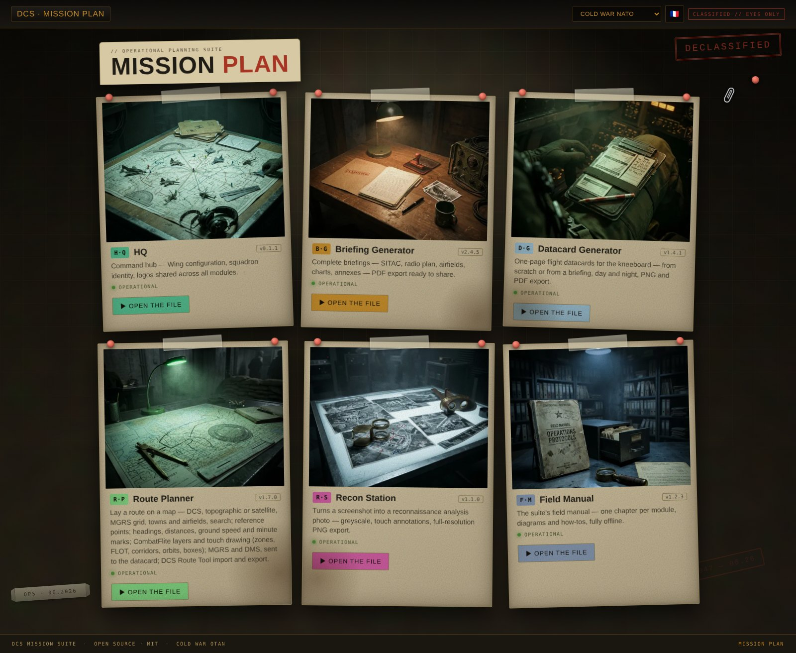
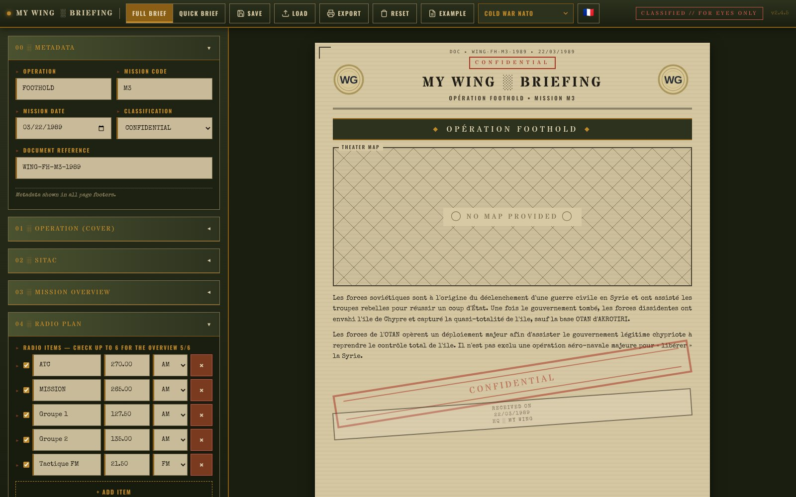
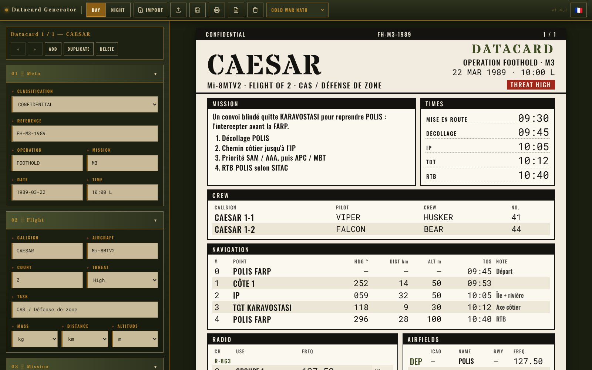
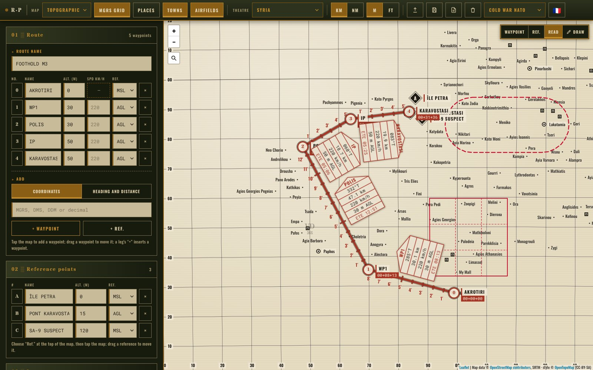
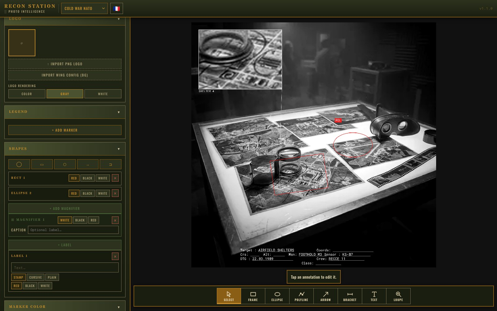

# DCS Mission Plan

<!-- Replace with a screenshot of the landing "situation board" (e.g. docs/screenshots/landing.png) -->

> Prepare your DCS World missions end to end — a suite of tools behind one operational landing page. **Use it online, or download a single offline file.**


> Aircraft, airfield and map data come from **[pydcs](https://github.com/pydcs/dcs)** (LGPL-3.0-or-later) — many thanks to its authors.

🌐 **[Use it online »](https://mirabellebenou.github.io/dcs-mission-plan/)** &nbsp;·&nbsp; 💾 **[Download the offline file »](../../releases)**

> 🗺️ **Thanks to the [DCS Olympus](https://github.com/Pax1601/DCSOlympus) team!** The Route Planner's **DCS map** layer uses the DCS map tiles they kindly share with the community — come and say hi on their **[Discord](https://discord.gg/kNAQkhUHnQ)**.
>
> 🧭 **Thanks to Flappie!** The Route Planner's **navigation chart** on the Caucasus is his accurate DCS map — see it on **[his website](http://dcsmaps.com/caucasus/openlayers)** or get the **[GeoTIFF on DCS User Files](https://digitalcombatsimulator.com/en/files/3305623/)**.

A single-page **"situation board"** that brings together a suite of mission-prep tools for DCS World virtual pilots and wings — staged like a Cold War operations table. Open the board, pick a tool, prepare your mission. It runs entirely in your browser: **online for those who don't want to download**, or as **one offline HTML file** you can keep, share, and use without internet.

Developped with the help of Claude AI (I'm not a dev !)

---

## 📱 Built for the tablet (and your phone)

Mission Plan is designed to be used **where you actually fly** — on a tablet next to your stick, or on your phone.

- **Touch-first UI** — large tap targets, drag-and-drop, no tiny desktop-only controls
- **Responsive layout** — split view on tablet/desktop, tabbed view on phone
- **Rotation-safe** — keeps working when you flip the tablet between landscape and portrait
- **No install** — open a link or a single file in the mobile browser; works offline once loaded
- **Export on the go** — generate PDF/PNG straight from the device

## 🧰 The suite

The landing page presents each tool as a **pinned print** on the board. Active tools open in place; upcoming ones are stamped *Coming soon*.

| Tool | What it does | Status |
|------|--------------|--------|
| **HQ** | Command post — configure your wing once (branding, squadrons), shared with the other tools; experimental `.miz` mission reader/patcher | 🧪 Beta `v0.1.1` |
| **Flight Configurator** | Prepare a flight for the Mission Commander — identity, radios, loadout built on the aircraft's front view or started from your presets, livery — and export it as a flight package that HQ applies to a mission; Mi-24P, Mi-8MT, F-4E and Mirage F1EE | 🧪 Beta `v0.1.0` |
| **Briefing Generator** | Mission briefings, full or quick — SITAC, radio plan, airfields, charts, recon photos, map from the Route Planner — PDF & PNG export | ✅ `v2.6.0` |
| **Recon Station** | Turn a screenshot into a reconnaissance analysis photo — sensor looks, annotations drawn by touch, lossless PNG | ✅ `v1.1.1` |
| **Field Manual** | In-app documentation for the suite — one illustrated chapter per tool, diagrams, FR/EN, offline | ✅ `v1.3.0` |
| **Route Planner** | Lay a route on a map — DCS map (by DCS Olympus), Flappie's navigation chart on the Caucasus, topographic or satellite, MGRS grid, place names, DCS towns and airfields, map search — type coordinates or heading & distance, reference points, headings, distances, MGRS & DMS, sent to the datacard; DCS Route Tool import & export; leg boxes, ground speed and minute marks; CombatFlite layers (.cf); draw your own layers by touch — circles, zones and curves, lines, FLOT and corridors, points, text, orbits, kill boxes with their grid; NATO military symbols (APP-6) — units, equipment, aircraft, FARP — filled or outlined, three sizes; magnetic headings with the variation computed like DCS, leg by leg; tap an airfield or heliport to open its chart from DCS Airfield Charts, served by the wing's server; send the framed map view to the Briefing Generator; a Display menu to show or hide the route, reference points, drawings, NATO symbols, imported layers, grid, towns, airfields and places | ✅ `v1.13.1` |
| **Datacard Generator** | One-page flight datacards for the kneeboard — from scratch, from a briefing or from a route — reference points, day & night, PNG & PDF export; magnetic headings computed like DCS | ✅ `v1.5.1` |

> Mission Plan is a single HTML file: every tool opens from its home page, and one **Save** writes all the work of the suite into one `.json` file that **Open…** brings back.

### 🛡️ HQ — your wing, configured once

HQ is the suite's **command post**. Its main job today is the **wing hub**: set your wing name, logo, squadrons and callsigns **once**, and Briefing Generator + Recon Station pick it up automatically. HQ also ships an **experimental `.miz` engine** (read a mission, export a mission snapshot, apply surgical patches) — the advanced flight-package UI is still in development and in-game validation is pending, so HQ is published as **beta**. HQ can also write **Dynamic Spawn** into a mission: mark flights as templates and link them to the airfields, FARPs and ships that already have Dynamic Spawn enabled in the mission editor (HQ never enables it). Its **Example** button loads a demonstration wing; your own configuration is kept and can be restored in one tap.

### ✈️ Flight Configurator — in detail

The Flight Configurator is the **Flight Lead's** tool: it prepares one or more flights and exports them as a **flight package** (`dcs-flight-package-v2`; the v1 packages are still read) that the Mission Commander applies to a mission with HQ. It runs for the **Mi-24P, Mi-8MT, F-4E-45MC and Mirage F1EE**.

- **Flights** — group name, aircraft, coalition, up to four units (name, call sign, onboard number, livery); flights fold into a one-line summary
- **Radios** — every radio of the aircraft, one field per channel, frequencies from 0 to 999.999 MHz (the Comm Plan Editor's rule); copy to the other units of the flight
- **Loadout** — built on the aircraft's **front view**: a weapon list per station, twin stations, total mass, and fuel, flares, chaff and gun brought back to the aircraft's limits; start from **My presets** (loaded from `.lua` preset files, or kept from your own loadouts)
- **Livery** — free text, with suggestions from the liveries already seen for that aircraft type
- **Import** — the mission loaded in HQ or a flight package (`.json` or `.zip`, including the Route Planner's), with four boxes per flight: Route, Radios, Loadout, Livery; the route is carried as is, never drawn
- **Open / Save** — **Save** writes all the Mission Plan work, your flights and presets included, into the suite's work file, and **Open ▾ › Open a work file…** brings it back (an old Flight Configurator file still opens); **Export** writes the package (parts left empty stay untouched in HQ)
- **Reusable loadout engine** — `payload_block.py` reads preset files and builds a `.miz` `payload`, with no DOM and no network; other modules can take it as is
- **4 themes, FR/EN**, touch-first, fully offline

### 🚀 Briefing Generator — in detail

Briefing Generator builds a **complete, shareable mission briefing** as a multi-section document, with **PDF and per-page PNG export** straight from the browser.

- **Sections** — cover, situation map (SITAC), charts, annexes, and mission phases
- **Radio & weather** — radio plan, METAR assistant, and **METAR import from a `.miz`**
- **Airfields** — structured airfield information
- **Wing branding** — pulled automatically from HQ (name, logo, squadrons)
- **Images** — drop in your own maps/charts; oversized images are auto-recompressed
- **4 themes, FR/EN**, multi-wing

### 🛰️ Recon Station — in detail

Recon Station turns any screenshot into a convincing **reconnaissance analysis photo**, fully in the browser, with **lossless full-resolution PNG export** (native Canvas 2D — what you preview is exactly what you export).

- **Sensor looks** — EO (default), IR white-hot, IR black-hot, SAR (stylizations, not radiometric data)
- **Image effects** — greyscale, contrast, vignette, grain, scanlines (sliders, off by default)
- **Annotations, by touch** — a drawing bar on the image: frames, ellipses, polylines, arrows, brackets, text labels (stamp, cursive grease-pencil, plain) and magnifiers; one tap places, large handles adjust (frames and magnifiers by their edges and corners, frames rotate); numbered movable markers
- **Editable info block** — 9 fields, bold text, black/white
- **Classification banner** — top/bottom bars, 4 levels, off by default
- **Wing logos** — upload manually or pull the shared wing branding from HQ; colour / grey / white modes
- **Example** — the top-bar button loads the STEPPE WIND example into the Mission Commander tools (this one and the Briefing Generator): a demonstration photo with its markers, shapes, magnifier and info block; **Restore** brings back the previous work, image included

### 📖 Field Manual — in detail

The Field Manual is the suite's **built-in documentation**, opened from the board like any other tool — **no internet, no separate guide to download**.

- **One chapter per tool** — Recon Station, HQ, Flight Configurator, Briefing Generator, Datacard Generator, Route Planner
- **Diagrams, not screenshots** — each chapter has a hand-drawn-style **SVG schematic** (e.g. *what feeds what* in the Briefing Generator) that adapts to the active theme
- **"What it's for" first** — plain explanations of each tool's purpose and workflow
- **4 themes, FR/EN**, fully offline

## ✨ Features

- **Online or fully offline** — use the hosted version, or one HTML file with no install, no server, no internet
- **One landing page** — embeds the live tools; open it, use it, share it
- **Tablet & mobile first** — see above 📱
- **4 graphical themes** — Cold War NATO (default), Cold War Soviet, Modern NATO, Modern Eastern Bloc — chosen on the board, carried across the tools
- **Bilingual** — full FR/EN toggle, shared across the suite
- **Configure your wing once** (HQ) — branding/squadrons shared with the other tools
- **PDF & PNG export** — straight from your browser
- **Auto-save** — your work is preserved in your browser's local storage

## 📸 Screenshots

**The board** — every tool on one page, 4 themes, FR/EN



**Briefing Generator** — the editor on the left, the printed briefing on the right



**Datacard Generator** — a one-page kneeboard datacard, built from scratch or from a briefing or a route



**Route Planner** — a route with leg boxes and minute marks, an orbit and a kill box drawn by touch



**Recon Station** — numbered targets with their legend, a frame, an ellipse and a magnifier drawn on the image, with the info block



<sub>Recon Station sample image (also the tool's built-in example): USDA National Agriculture Imagery Program (NAIP) aerial photograph, public domain.</sub>

## 🚀 Quick Start

**Option A — online (nothing to download)**
1. Open **[the hosted version](https://mirabellebenou.github.io/dcs-mission-plan/)** in your browser (works on phone/tablet too)
2. Pick a tool on the board and go

**Option B — offline file**
1. Download the latest `dcs_mission_plan.html` from the [Releases](../../releases) page
2. Open it in any modern browser (Chrome recommended) — on PC or tablet
3. It keeps working offline; bookmark or "Add to Home Screen" on mobile

No account, no internet required after the first load.

Every tool has an **Example** button, and the landing page has two, one in each frame (Mission Commander, Flight Leader). There is one example, the fictional STEPPE WIND operation over Cyprus, and it loads by group: the Mission Commander button fills the Briefing Generator and the Recon Station, the Flight Leader one fills the Route Planner, the Datacard Generator and the Flight Configurator; **Restore** brings back the group's previous work — the quickest way to see what the suite does.

## 🛡️ For wing administrators

Customize the branding for your virtual wing — done once, in **HQ**, and shared with every tool:

1. Open **HQ** from the board
2. Set the wing name, logo, squadrons, callsigns
3. The configuration is shared automatically with Briefing Generator and Recon Station (and exportable to hand to your pilots)

The default `MY WING` configuration is generic — replace it with your own.

## 📓 Changelog

See [CHANGELOG.md](./CHANGELOG.md) for the per-tool version history.

## 🏗️ Building from source

If you want to modify the code yourself.

### Prerequisites
- Python 3.8+ (standard library only)

### Build
Each tool builds to an HTML module (a build step, not a file to open on its own), then the landing page embeds them:

```bash
# 1) Build the tools
python3 build_briefing_generator.py             # → dist/dcs_briefing_generator.html
python3 build_recon_station.py                  # → dist/dcs_recon_station.html
python3 build_hq.py                             # → dist/dcs_hq.html
python3 build_flight_configurator.py            # → dist/dcs_flight_configurator.html
python3 build_field_manual.py                   # → dist/dcs_field_manual.html
python3 build_datacard_generator.py            # → dist/dcs_datacard_generator.html
python3 build_route_planner.py                 # → dist/dcs_route_planner.html

# 2) Assemble the landing page (embeds the tools + board tiles)
python3 build_mission_plan.py                   # → dist/dcs_mission_plan.html
```

Opened on its own, a module only shows a line pointing to Mission Plan.

Run the seven tool builds first, then the landing-page build: the latter reads the seven modules from `dist/` and the tiles from `tiles/`. Inputs (`assets.json`, `tiles/`) are read from the repository, and a build stops with a non-zero exit code if one is missing.

The output `dist/dcs_mission_plan.html` is the distributable (and the file published online). `docs/index.html` is a byte-for-byte copy of `dist/dcs_mission_plan.html`, made at each milestone.

### Project structure
```
.
├── build_mission_plan.py          # Landing/shell builder — embeds tools + tiles
├── build_briefing_generator.py    # Briefing Generator builder (single script)
├── build_recon_station.py         # Recon Station builder
├── build_hq.py                    # HQ builder
├── build_flight_configurator.py   # Flight Configurator builder
├── payload_block.py               # Shared loadout block (preset files, .miz payload), no DOM
├── radio_bands_block.py           # Shared radio bands and non-preset radios block (Flight Configurator, Datacard Generator, HQ, Route Planner), no DOM
├── aircraft_types_block.py        # HQ's game aircraft types block (reads data/aircraft_types.json), no DOM
├── build_field_manual.py          # Field Manual builder
├── build_datacard_generator.py    # Datacard Generator builder
├── build_route_planner.py         # Route Planner builder
├── assets.json                    # Embedded fonts, libraries, kraft texture (base64)
├── airfields.json                 # DCS airfield & helipad positions (from pydcs)
├── airdromes.json                 # DCS airfield names and ids per theatre (from pydcs, via DCS Airfield Charts)
├── towns.json                     # DCS town names & positions (from the DCS World maps)
├── data/                          # Flight Configurator tables (weapons, pylons, limits, front views from Mission Tools), HQ's aircraft types, and their licences
├── wmm/                          # World Magnetic Model coefficients 1985–2025 (NOAA, public domain)
├── igrf/                         # IGRF-12 coefficients 1900–2015 (IAGA, as shipped by DCS World)
├── tiles/                         # Board tiles (512² WebP): hq, bg, rs, fm, rp, kg, fc
├── docs/screenshots/              # README images
├── CHANGELOG.md
├── README.md
└── LICENSE
```

### Shared loadout block (`payload_block.py`)

The module's “loadout” part lives in a **shared JavaScript block**, `payload_block.py`: no DOM, no `t()`, no network, it runs alone under `node`. Another module takes it **as is**: the block's text is byte-identical in every `dist/` file that uses it. It reads three tables set before it, under these names: `WEAPON_NAMES` (CLSID → name), `AIRCRAFT_PYLONS` (permitted weapons and masses per station) and `AIRCRAFT_LIMITS` (fuel, countermeasures), the same ones as Mission Tools' Loadout Editor.

- **`parseUnitPayloads(text)`** reads a preset `.lua` file (the Lua subset of those files: tables, strings, numbers, booleans, comments). It returns `{ unitType, supported, presets: [{ name, displayName, pylons: { number: { CLSID, settings? } } }] }`; `supported` is false for any type other than the four handled (the file reads, but is offered to no group). A read error carries `.line` (the line number), `.code` and `.detail`. A station's `settings` are returned as they are.
- **`buildPayload(type, pylons, { fuel, flare, chaff, gun })`** returns a .miz `payload` object: `pylons` numbered by station (`{ CLSID, settings? }`), `fuel`, `flare`, `chaff`, `gun` brought within the table's limits, and the type's fixed keys (`ammo_type`, `restricted`), as missions write them: the Mi-8MT's fuel is a string, the other three's a number. Helpers read the tables: `payloadPylons(type)`, `payloadWeaponName(clsid)`, `payloadWeaponMass(clsid)`, `payloadDefaults(type)`. `payloadMirrorClsid(clsid, allowedOnTwin)` returns the mirror weapon to put on the twin station (same CLSID, else Left↔Right, else the only weapon with the same name) or an empty string. `payloadWeaponSide(type, clsid)` returns `'L'`, `'R'` or `''`: the side of a weapon whose name is carried by several CLSIDs of the same aircraft, when its CLSID carries one (`Left`/`Right`, `LEFT`/`RIGHT`, `_L`/`_R` at the end); the “left” / “right” text is the caller's. To reuse the block: set the three tables, insert the block's text, call these functions.

## 🗺️ Roadmap

### ⏳ Work in Progress
- ⏳ **HQ** — flight-package / Commander UI, and in-game `.miz` validation (out of beta)
- ⏳ **Route Planner** — NATO symbols, clock times from a TOT, read routes from a `.miz`, automatic magnetic variation, kneeboard export
- ⏳ **Datacard Generator** — import waypoints and loadouts from HQ (`.miz`)
- ⏳ **UI polish** and more themes

### 📋 Planned (Briefing Generator)
- Auto-save indicator, briefing templates (CAS / CAP / SEAD), URL-based sharing
- Full-screen presentation mode, recurring-charts library
- Briefing versioning + diff, auto checklist validation

## 🤝 Contributing

Bug reports and feature suggestions are welcome via the [Issues](../../issues) page.

For code contributions: fork, branch, study the build scripts to understand the architecture, test by rebuilding and opening the result in a browser, then open a pull request.

## ⚠️ Compatibility

- **Chrome / Edge** (recommended): all features, including print-to-PDF
- **Firefox**: works; PDF rendering may differ slightly
- **Safari** (macOS & iOS): works, minor visual variations
- **Mobile browsers** (Android/iOS): supported and a first-class target — touch, drag, rotation

## 📄 License

[GNU AGPL-3.0-or-later](https://github.com/MirabelleBenou/dcs-mission-plan/blob/main/LICENSE) — free to use, modify and share, commercial use included (a paid service too), **provided the source code of your version is published under the same licence**, hosted services included (section 13). Every interface must keep the credit line “Based on Mission Plan by MirabelleBenou and the 4th VEAW virtual wing” (an additional term under section 7(b), see `LICENSE`). Releases up to v1.24.0 remain under the MIT licence. Exceptions: the Flight Configurator's front-view drawings (by Goldwolf, `data/views/LICENSE.md`) and the pydcs-derived tables (LGPL-3.0-or-later, `data/COPYING.LESSER`).

## 🙏 Acknowledgments

- Built for the DCS World virtual aviation community
- DCS map tiles by the **[DCS Olympus](https://github.com/Pax1601/DCSOlympus)** team — [Discord](https://discord.gg/kNAQkhUHnQ)
- Caucasus navigation chart by **Flappie** — [his website](http://dcsmaps.com/caucasus/openlayers) and the [GeoTIFF on DCS User Files](https://digitalcombatsimulator.com/en/files/3305623/), many thanks to him!
- Map engine [Leaflet](https://leafletjs.com) (BSD-2-Clause); topographic tiles © OpenStreetMap contributors, SRTM, style © OpenTopoMap (CC-BY-SA); satellite imagery © Esri, Maxar, Earthstar Geographics
- NATO military symbols drawn with **[milsymbol](https://github.com/spatialillusions/milsymbol)** by Måns Beckman (MIT)
- DCS airfield & helipad names and positions, and the DCS map projections, from **[pydcs](https://github.com/pydcs/dcs)** (LGPL-3.0-or-later); place-name overlay © Esri, HERE, Garmin, OpenStreetMap contributors
- Airfield names and ids: pydcs, via DCS Airfield Charts
- Datacard Generator: today's ICAO codes of the airfields from **[OurAirports](https://ourairports.com/)** (public domain), matched by position, via DCS Airfield Charts (`airfield_icao.json`)
- Flight Configurator: weapon names, permitted weapons per station, masses and aircraft limits from **[pydcs](https://github.com/pydcs/dcs)** (LGPL-3.0-or-later, `data/COPYING.LESSER`), taken from Mission Tools; the front-view aircraft drawings are by **Goldwolf** (DCS Reference Guide), used with his permission and **not** under this repository's AGPL licence — see `data/views/LICENSE.md`
- HQ: the game's flyable aircraft types offered for a squadron, from **[pydcs](https://github.com/pydcs/dcs)** 1.0.0 (LGPL-3.0-or-later, `data/aircraft_types.json`)
- DCS town names and positions from the DCS World maps, © Eagle Dynamics
- World Magnetic Model coefficients (epochs 1985–2025, the ones DCS World ships) by NOAA NCEI and the British Geological Survey, public domain
- International Geomagnetic Reference Field, 12th generation (IAGA), in the NOAA geomag70 file DCS World ships, used for years up to 1984
- Cold War kraft SVG file provided by Flappie, thanks to him !

---

*This project is not affiliated with or endorsed by Eagle Dynamics, the developers of DCS World.*
